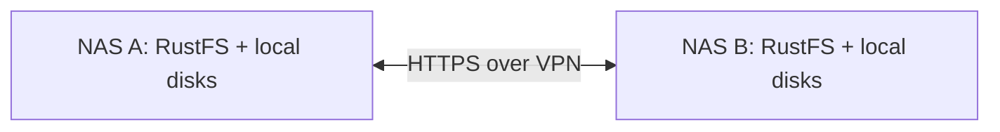

# Replicate RustFS between two NAS locations

Deploy one independent RustFS instance on each NAS, join the locations through a
VPN, and link the instances with **site replication**. Both locations can accept
S3 writes. RustFS performs the transfers asynchronously after the initial setup;
the administration client does not need to stay running.



This synchronizes RustFS object storage. SMB/NFS folders outside RustFS require a
separate file synchronization solution. Do not synchronize RustFS's live `/data`
directories using rsync, or mount the same data directory in two instances.

## Files and assumptions

| File | Purpose |
| --- | --- |
| `docker-compose.rustfs-replication.yml` | Start one persistent RustFS instance on each NAS. |
| `rustfs-replication.env.template` | Per-NAS paths, VPN address, image and credentials. |
| `rustfs-site-replication.sh` | Link two configured `rc` aliases once, or inspect both sites. |

The example pins `rustfs/rustfs:1.0.1`, a published stable release with replication
fixes. Use the same server release on both NAS devices. Install the official
RustFS **`rc` client** on a trusted administration machine; the current CLI release
checked when preparing this guide is `v0.1.36`. The helper script requires Bash on
the administration machine. Use Docker Engine with the Compose plugin on each NAS.

The existing `docker-compose.rustfs.yml` and `rustfs-replication.sh` remain a
separate configuration. The old script assumes local Docker names `rustfs` and
`rustfs2` and configures bucket rules; do not run it for this site-replication
setup. Run the new Compose file on both NAS devices, not two copies on one NAS.

## 1. Connect the locations

Set up WireGuard or Tailscale before starting the containers. These example
values must be replaced with your actual VPN addresses and DNS names:

| Setting | NAS A | NAS B |
| --- | --- | --- |
| VPN IPv4 address | `10.77.0.1` | `10.77.0.2` |
| DNS name resolving to that VPN address | `nas-a.example.com` | `nas-b.example.com` |
| S3 endpoint | `https://nas-a.example.com:9002` | `https://nas-b.example.com:9002` |
| Console host binding | `127.0.0.1:9003` | `127.0.0.1:9003` |

Both NAS devices, both RustFS containers, and the administration machine must
resolve and reach these S3 endpoints. A Docker bridge network is local to one
host; it does not connect the two locations. Check VPN routing, Docker outbound
access, and VPN MTU if larger transfers stall.

Allow the peer NAS and authorized clients to access TCP `9002` over the VPN.
Account for Docker's published-port firewall rules when restricting access. No
public Internet port forwarding is required. Keep the VPN available across NAS
reboots; Docker cannot publish an address that has not yet appeared.

## 2. Configure each NAS

From the repository root on **each NAS**, make a local configuration file:

```bash
cp -n rustfs-replication.env.template rustfs-replication.env
chmod 600 rustfs-replication.env
```

Edit the file. Set `RUSTFS_BIND_IP` to that NAS's VPN IP. Set a unique access key
and a separately generated secret on each NAS, for example using
`openssl rand -hex 32`. Use an editor rather than putting populated credentials
in shell history. The populated environment file is ignored by Git.

Set the three absolute storage paths to directories on your NAS data volume.
The `/srv` paths in the template are examples: confirm that they reside on the
intended persistent filesystem. Create new, dedicated directories. Do not point
this configuration at the existing running RustFS instance's storage.

For the template paths, prepare ownership for the image's UID/GID `10001:10001`:

```bash
sudo install -d -m 0750 -o 10001 -g 10001 /srv/rustfs-replication/data
sudo install -d -m 0750 -o 10001 -g 10001 /srv/rustfs-replication/logs
sudo install -d -m 0750 -o root -g 10001 /srv/rustfs-replication/certs
```

Each NAS needs a TLS certificate matching its DNS name. Use a certificate trusted
by the peer container and the administration machine; a public CA certificate
obtained through DNS validation works even with private VPN addresses. Install
the full certificate chain and corresponding private key under these exact names:

```bash
# Substitute the actual certificate and key source paths on each NAS.
sudo install -m 0644 /path/to/fullchain.pem /srv/rustfs-replication/certs/rustfs_cert.pem
sudo install -m 0640 -o root -g 10001 /path/to/privkey.pem /srv/rustfs-replication/certs/rustfs_key.pem
```

The certificate directory is mounted read-only. Copy actual files; symlinks to
files outside the mounted directory will not work inside the container. Arrange
certificate renewal and restart the service after replacing the pair. If using
a private CA, provision its trust into **both server containers and the client**
before linking; that additional CA provisioning is not included in this Compose
file. Do not disable peer certificate verification as a workaround.

## 3. Start the service on both NAS devices

Run from the repository root on each NAS:

```bash
docker compose --env-file rustfs-replication.env -f docker-compose.rustfs-replication.yml config --quiet
docker compose --env-file rustfs-replication.env -f docker-compose.rustfs-replication.yml pull
docker compose --env-file rustfs-replication.env -f docker-compose.rustfs-replication.yml up -d
docker compose --env-file rustfs-replication.env -f docker-compose.rustfs-replication.yml ps
```

Use `config --quiet`: the normal rendered configuration includes credentials.
Required values and existing bind-mount directories are enforced. The Compose
project has its own name and does not use the old fixed `rustfs` container name.
Its default host ports are still `9002`/`9003`; stop a previous service using those
ports or choose free ports in the new environment file and update all endpoints.
Never attach both services to the same data directory.

From the administration machine, check HTTPS readiness at each endpoint:

```bash
curl --fail https://nas-a.example.com:9002/health
curl --fail https://nas-b.example.com:9002/health
```

Also verify the path from the containers themselves. For example, on NAS A:

```bash
docker compose --env-file rustfs-replication.env -f docker-compose.rustfs-replication.yml exec rustfs curl --fail https://nas-b.example.com:9002/health
```

Run the corresponding check toward NAS A from NAS B. Fix DNS, VPN routing, or
certificate trust failures before proceeding. Use the S3 API endpoint, never the
Console port, as a replication target.

## 4. Link the sites once

Start with empty deployments for the first trial. Before connecting existing
sites, inventory bucket names, versioning, Object Lock settings and IAM identities
for conflicts, and preserve a separate recovery copy.

Install `rc` using the [official client installation guide](https://docs.rustfs.com/en/operations/rc).
Check `rc --version` and `rc admin replicate --help`. Configure the following
aliases on the administration machine. This example uses an interactive **Bash**
session so credential values are read without being entered in command history:

```bash
bash
umask 077
read -r -p 'NAS A access key: ' NAS_A_KEY
read -r -s -p 'NAS A secret key: ' NAS_A_SECRET; printf '\n'
rc alias set nas-a https://nas-a.example.com:9002 "$NAS_A_KEY" "$NAS_A_SECRET" --region us-east-1 --bucket-lookup path
unset NAS_A_KEY NAS_A_SECRET

read -r -p 'NAS B access key: ' NAS_B_KEY
read -r -s -p 'NAS B secret key: ' NAS_B_SECRET; printf '\n'
rc alias set nas-b https://nas-b.example.com:9002 "$NAS_B_KEY" "$NAS_B_SECRET" --region us-east-1 --bucket-lookup path
unset NAS_B_KEY NAS_B_SECRET
```

Use each NAS's root administrative credentials for this operation. Protect the
client alias store, which retains those credentials, and avoid shell tracing.
From a checkout of this repository on the same administration machine, run:

```bash
./rustfs-site-replication.sh link nas-a nas-b
```

This establishes the relationship and reports both sites' views. Site replication
covers buckets, object versions and supported IAM data; its setup configures the
underlying replication targets. Compatible bucket-versioning support is required.
The `rc` process then exits. **No cron task or continuously running setup script
is needed.** Restarting a container with the same persistent storage retains its
configuration; do not re-run `link` on every startup.

If `link` times out or fails, inspect both sites before repeating the mutation:

```bash
./rustfs-site-replication.sh status nas-a nas-b
```

Do not combine this with independent bucket rules for the same data during the
initial setup. For selected buckets only, use bucket replication instead of
whole-site linking; see the alternative below.

## 5. Verify data transfer and interruption recovery

Use a new disposable bucket name and unique test keys. After linking:

```bash
rc bucket create nas-a/replication-smoke-test
printf 'uploaded at NAS A\n' > /tmp/rustfs-from-a.txt
rc object copy /tmp/rustfs-from-a.txt nas-a/replication-smoke-test/from-a.txt
rc object stat nas-b/replication-smoke-test/from-a.txt
rc object copy nas-b/replication-smoke-test/from-a.txt /tmp/rustfs-from-a-downloaded.txt
cmp /tmp/rustfs-from-a.txt /tmp/rustfs-from-a-downloaded.txt

printf 'uploaded at NAS B\n' > /tmp/rustfs-from-b.txt
rc object copy /tmp/rustfs-from-b.txt nas-b/replication-smoke-test/from-b.txt
rc object stat nas-a/replication-smoke-test/from-b.txt
rc object copy nas-a/replication-smoke-test/from-b.txt /tmp/rustfs-from-b-downloaded.txt
cmp /tmp/rustfs-from-b.txt /tmp/rustfs-from-b-downloaded.txt
```

Replication takes time: wait and repeat the target-side `stat` until the object
appears before downloading. An absent bucket immediately after creation can also
be transient. Inspect bucket versioning at both sites:

```bash
rc bucket version info nas-a/replication-smoke-test
rc bucket version info nas-b/replication-smoke-test
```

Then test overwrites and deletion behavior using only disposable objects and
inspect version history at both sites. Temporarily interrupt the site-to-site
VPN path while retaining local/console access, upload new uniquely named objects
locally, restore connectivity, and verify their contents at the other site.
Test NAS/container restarts as well. Avoid concurrent writes to the same key
until your application has tested and accepted the resulting conflict behavior.

## Operations and recovery

Run `./rustfs-site-replication.sh status` regularly and verify representative
objects in addition to checking status. Observe disk space, failures, and backlog
from both sites. Plan WAN capacity for the initial copy and subsequent changes;
if writes continuously exceed the transfer rate, the remote copy falls behind.

If a repaired peer still lacks data, investigate status and logs before starting
a resync. Identify the exact peer deployment ID with `rc admin replicate info`,
then follow the upstream resync runbook. The documented resync status reflects a
persisted request result rather than live worker progress; avoid repeated starts
after an ambiguous response.

For this local instance's container output:

```bash
docker compose --env-file rustfs-replication.env -f docker-compose.rustfs-replication.yml logs --tail=100 rustfs
```

RustFS application logs also live in the configured log directory. Manage their
retention separately from Docker's bounded stdout logs. Container shutdown with
`docker compose ... down` retains the bind-mounted files. Keep data and metadata
together, and never erase storage as a way to reconnect a peer.

The Console is bound to loopback. To access NAS A's Console from a workstation,
create `ssh -N -L 9003:127.0.0.1:9003 user@nas-a.example.com`, map
`nas-a.example.com` to `127.0.0.1` temporarily on that workstation, then browse to
`https://nas-a.example.com:9003` so the certificate hostname still matches.
Use another local port for a simultaneous NAS B tunnel.

Replication has a nonzero recovery window and propagates destructive changes.
Keep independent backups or suitable retention for accidental deletion and
compromise. Application endpoint switching and disaster recovery procedures are
separate from replication. Each example site is a single server with one data
path; provide suitable local disk redundancy for your availability requirements.

## Alternative: replicate selected buckets

For a primary NAS with an off-site copy, use directional bucket replication.
Enable versioning on both buckets, create a dedicated destination credential,
and configure whether historical objects, delete markers and permanent version
deletions should propagate. A second rule in the reverse direction permits
two-way bucket replication when required. Do not use the whole-site `link`
command for this alternative. Follow the bucket guide for exact commands and
permission requirements.

## Validation performed

The Compose configuration and required-value guards passed validation. An
isolated test using RustFS `1.0.1`, CLI `0.1.36`, temporary Docker volumes and a
trusted test CA linked two HTTPS sites, verified matching object contents in both
directions, and confirmed versioning was enabled. The test containers, network
and volumes were removed afterward. Actual NAS disks, certificates, VPN paths
and outage recovery still need the deployment checks described above.

## References

- [RustFS site replication](https://docs.rustfs.com/en/operations/high-availability/site-replication)
- [RustFS bucket replication](https://docs.rustfs.com/en/administration/data/bucket/replication)
- [Docker deployment and directory permissions](https://docs.rustfs.com/en/installation/container/docker)
- [TLS configuration and certificate filenames](https://docs.rustfs.com/en/integration/tls-configured)
- [RustFS 1.0.1 release](https://github.com/rustfs/rustfs/releases/tag/1.0.1)
- [RustFS CLI releases](https://github.com/rustfs/cli/releases)

Prepared against the upstream documentation and published images on 2026-10-16.
